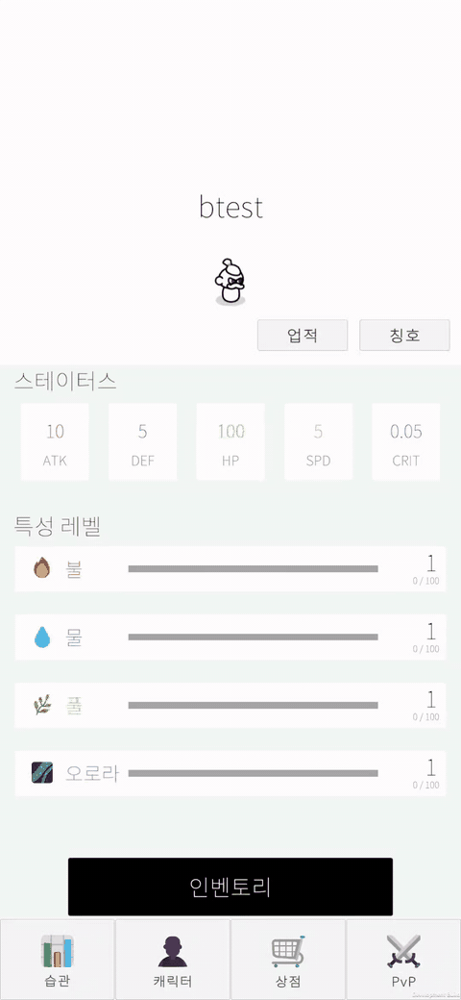
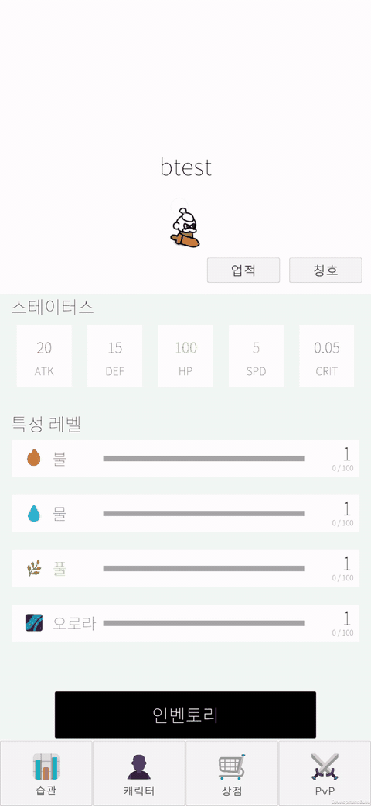

# HabitGame : 습관 형성 및 관리 게이미피케이션 앱

  
  

> 생활·소비 습관의 목표 달성을 캐릭터 성장과 재화 보상으로 연결하고, 아이템 구매·장비 강화·1대1 자동 턴제 PvP로 이어가는 **습관 형성 도우미 게이미피케이션 앱**입니다. 
> 3인 팀(클라이언트 2명, 백엔드 1명)에서 개발 리드와 클라이언트 개발을 맡아, **서버 데이터 기반의 일관된 상태 관리**와 **협업 기반 마련 및 시스템 통합**에 집중했습니다.

 

## 기술 스택

* **엔진:** Unity 2022.3.62f3
* **언어:** C#
* **멀티플레이**: Photon PUN 2
* **서버 통신**: UnityWebRequest 기반 REST API 연동
* **버전 관리:** Git, GitHub, Sourcetree

 

## 주요 구현 기능 및 기여

### 1. 서버 연동 공통 구조

* **서버 연동 구조:** 서버 통신을 위한 ApiClient·DTO·Service 구조의 초안을 구성하고, ServiceRegistry를 통해 서비스 접근 경로를 일원화

### 2. 아이템 상태 동기화

* 구매·장착·사용 결과가 인벤토리, 캐릭터 능력치, PvP 준비 데이터까지 일관되게 반영되도록 장착·사용 처리 경로를 InventoryManager로 통합

### 3. UI 슬롯 오브젝트 풀링

* 상점·인벤토리·랭킹 등 반복 갱신되는 목록 UI에 슬롯 풀링을 적용하여 오브젝트의 반복 생성·삭제 비용을 절감

### 4. 1대1 자동 턴제 PvP

* **매칭 및 준비 검증:** Photon 기반 매칭부터 양측의 Ready 상태와 전투 데이터 등록 확인까지 이어지는 준비 흐름 구축
* **단일 판정 및 전투 연출:** Master Client가 최대 15턴의 전투 결과를 사전 계산하고, 전투 로그를 공유해 양측 클라이언트가 동일한 결과를 순서대로 연출하도록 구성

### 5. 협업 주도

* **협업 기반 마련:** 프로젝트 초기 Unity·GitHub 환경 설정과 익숙하지 않은 팀원의 온보딩을 지원하고, 팀원별 브랜치·작업 씬 분리 및 메인 씬 통합 담당
* **메타파일 충돌 해결:** 병합 후 충돌 표시가 남은 Unity 메타파일을 정상화하고, 팀원들의 로컬에 남은 해당 파일을 제거한 뒤 정상 파일로 대체하도록 조율해 작업 환경 복구

 

## 개선 방안

* **상점 요청 병렬화**
  * **한계:** 서로 독립적인 캐릭터 정보와 상품 목록의 서버 요청을 순차적으로 처리해 대기 시간이 누적되고, 상점 화면 전환의 지연이 길어짐
  * **해결 과정:** 두 요청을 병렬 처리하도록 변경. 무선 네트워크의 Unity Editor 환경에서 조건별 30회 측정한 결과, 상점 오픈 로직 소요 시간의 중앙값을 397ms → 201.5ms로 약 49% 단축

* **PvP 전투 종료 후 준비 로직 재실행 오류 해결**
  * **문제 상황:** 종료 처리에서 Ready 해제가 누락되고, 준비 판정에서도 참여 인원과 종료 상태를 검증하지 않아, 결과창을 닫은 뒤 준비 로직이 재실행되며 전투 유닛 생성 실패 오류 발생
  * **해결 과정:** 전투 데이터와 Ready 상태를 함께 초기화하고, 2인 참여 여부와 종료·퇴장 상태를 진입 조건에 반영해 속성 변경 콜백에 의한 준비 로직 재실행 차단
 

## 링크

* [백엔드 저장소](https://github.com/gen0524/habit-pvp-server)
* [상세 포트폴리오 (Notion)](https://app.notion.com/p/HabitGame-3fa5968681bd80f18fd7c5b5be932932?source=copy_link)
